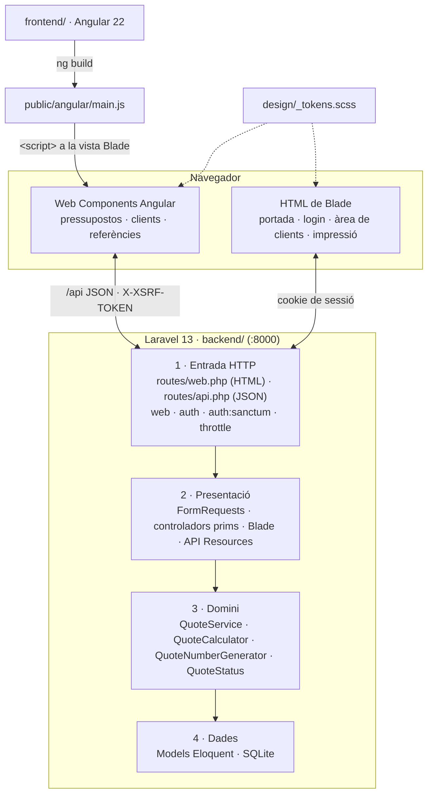
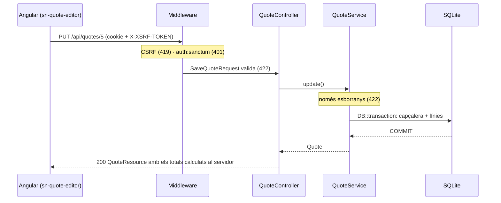
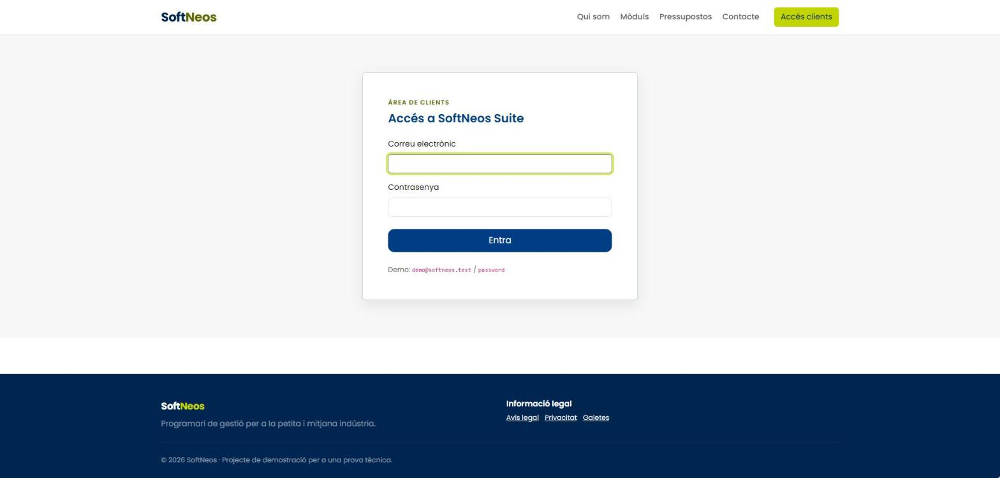
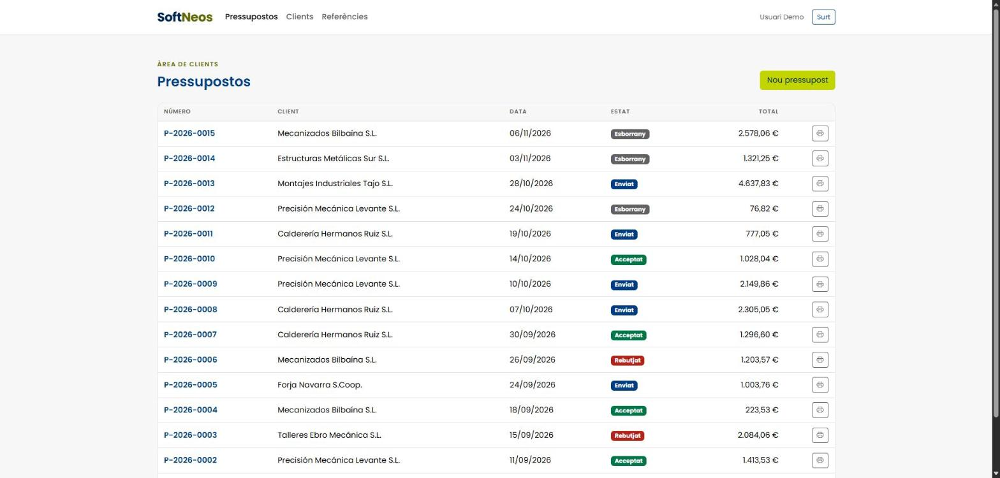
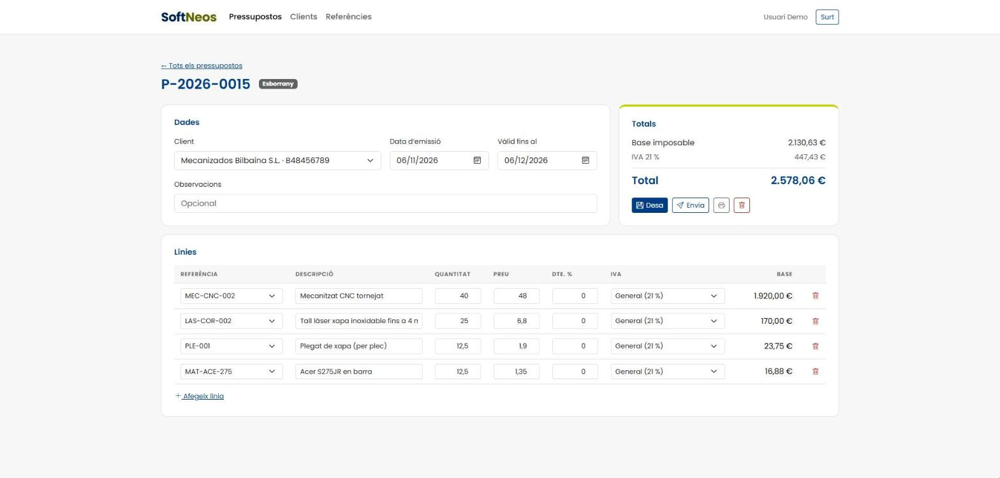
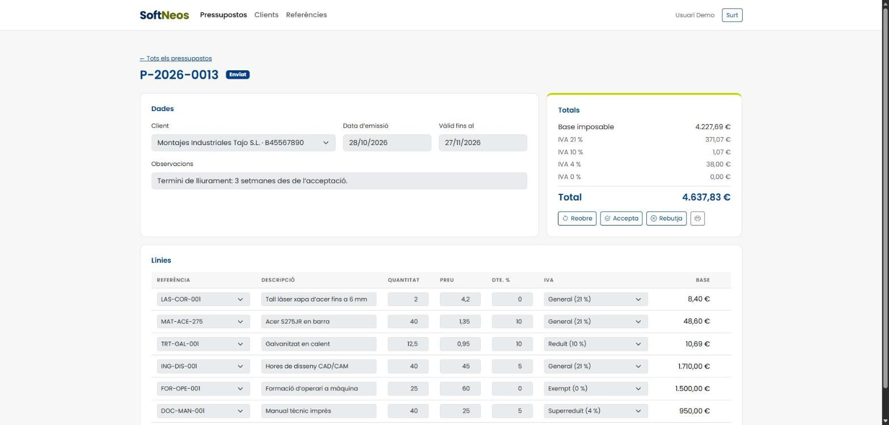
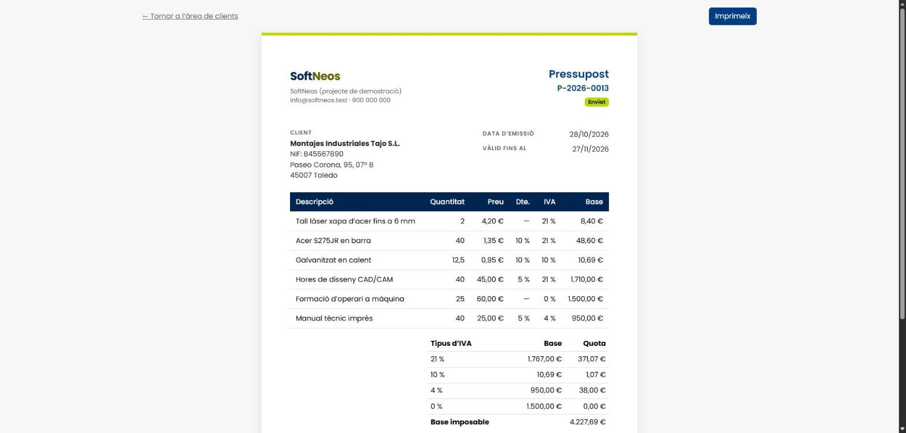
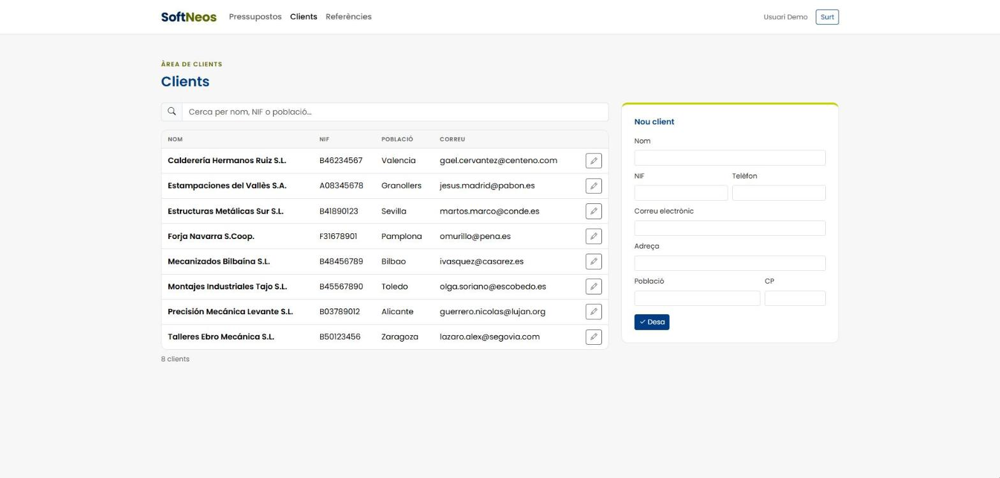
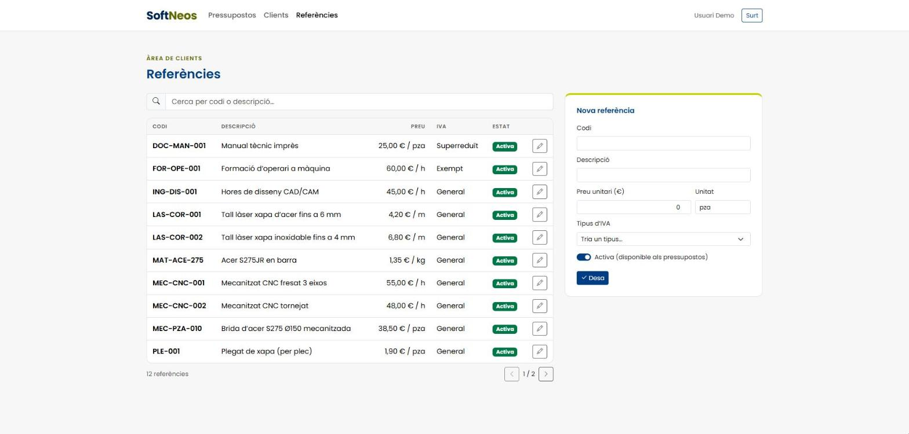

# SoftNeos Pressupostos

> Web corporativa de SoftNeos feta amb Blade i una àrea de clients amb pantalles Angular, dins de les mateixes pàgines de Laravel.

Prova tècnica «Disseny + programació» (enunciat literal a [`docs/ENUNCIAT.md`](docs/ENUNCIAT.md)).


## Descripció

- **Web corporativa (Blade):** una sola pàgina amb capçalera destacada, qui som, mòduls de SoftNeos Suite i contacte. **Els mòduls es llegeixen de la base de dades** (taula `suite_modules`), sense haver d'iniciar sessió.
- **Àrea de clients (Blade + Angular):** inici de sessió amb la sessió de Laravel, gestió de pressupostos i manteniment de clients i referències. Les pantalles interactives són **components Angular registrats com a Web Components** (`<sn-quote-list>`, `<sn-quote-editor>`, `<sn-customer-list>`, `<sn-reference-list>`) que Blade insereix com qualsevol etiqueta HTML.
- **Vista imprimible (Blade):** pressupost en format A4 amb el desglossament d'IVA, preparat per a Ctrl+P.

Tota la interfície és en català. Les dades de demostració són de tallers fictius del sector del metall.

## Tecnologies

| Peça | Versió |
| --- | --- |
| Laravel | 13.x |
| PHP | 8.3 o superior (desenvolupat amb 8.5) |
| Angular | 22.2 (`@angular/elements`, signals, sense zone.js) |
| Bootstrap | 5.3 personalitzat amb SCSS |
| Base de dades | SQLite |
| Autenticació | Sessió de Laravel + Sanctum en mode SPA per a `/api` |
| Tests | PHPUnit (backend) |

## Arquitectura

Blade és el motor de plantilles de tota la web; Angular aporta les vistes interactives dins d'aquestes plantilles. Un sol servidor, un sol origen i una sola sessió: sense proxy i sense CORS.



Flux en desar un pressupost:



```text
softneos-quotes/
├── backend/     Laravel: Blade, API, domini i tests
├── frontend/    Angular: components compilats com a Web Components
├── design/      _tokens.scss compartit per Vite (Blade) i Angular CLI
└── docs/        Enunciat, especificació, ús de la IA i captures
```

## Instal·lació

Requisits: PHP 8.3 o superior amb les extensions `pdo_sqlite`, `bcmath`, `intl`, `mbstring` i `fileinfo`; Composer; Node.js 22 o superior i npm.

```bash
git clone https://github.com/MGurtD/softneos-quotes.git
cd softneos-quotes/backend
composer install
cp .env.example .env
php artisan key:generate
php -r "touch('database/database.sqlite');"   # fitxer SQLite buit (Windows, macOS i Linux)
php artisan migrate --seed
npm install && npm run build    # CSS de Blade (Bootstrap + tokens)
cd ../frontend
npm install && npm run build    # Angular -> backend/public/angular/main.js
cd ../backend
php artisan serve
```

Obre <http://localhost:8000>.

## Ús

- **Credencials de demostració:** `demo@softneos.test` / `password` (botó «Accés clients»).
- **Rutes principals:**
  - `/` portada · `/login` inici de sessió
  - `/pressupostos` llistat · `/pressupostos/nou` i `/pressupostos/{id}` editor · `/quotes/{id}/print` vista imprimible
  - `/clients` i `/referencies` catàlegs (cerca, alta i edició)
- **Mode desenvolupament** (tres terminals): `php artisan serve` i `npm run dev` a `backend/`; `npm start` a `frontend/` (recompila Angular en desar).
- **Restablir les dades de demostració:** `php artisan migrate:fresh --seed` (les dades són sempre les mateixes: Faker amb llavor fixa).

## Tests

```bash
cd backend
php artisan test
```

19 tests: càlcul de totals i IVA (unitaris), màquina d'estats, numeració correlativa per any, API de pressupostos (401, 422, transicions i filtres), inici de sessió, portada amb contingut de la base de dades i vista imprimible.

## Decisions tècniques

- **Blade + Angular Elements en lloc d'una SPA separada.** L'enunciat demana la web «a través de views/blades de Laravel, però també a través de views html que utilitzin Angular». Blade renderitza i protegeix cada pàgina (`auth`); Angular només dona vida a les parts interactives. Resultat: un sol origen, i la cookie de sessió i el token XSRF funcionen sense configuració.
- **Contingut públic des de la base de dades.** Els mòduls de la portada surten de `suite_modules`: afegir-ne un és un canvi de dades, no de codi.
- **Diners exactes.** Columnes `decimal`, cast `decimal:2` i càlcul amb bcmath, arrodonint *half up* per línia. `QuoteCalculator` és l'única font de veritat: l'API, la vista imprimible i Angular mostren el mateix total. Angular només en fa una previsualització mentre s'edita.
- **Còpies (snapshots) a les línies.** Cada línia copia la descripció, el preu, el tipus d'IVA i el percentatge en crear-se: un canvi posterior al catàleg o a la llei no altera els pressupostos emesos.
- **Regles de negoci fora dels controladors.** `QuoteStatus::canTransitionTo()` decideix les transicions; `QuoteService` aplica «només els esborranys són editables» i desa la capçalera i les línies en una transacció. Els errors de regla responen 422 amb el mateix format que la validació.
- **Errors de validació per camp.** `core/form-errors.ts` col·loca cada missatge 422 de Laravel al seu control del Reactive Form (per exemple, un NIF duplicat), de manera que la regla `unique` del servidor es veu al camp que toca.
- **Assignació massiva.** `number` i `status` no són `#[Fillable]`: el servidor assigna el número, i l'estat només canvia amb `PATCH /status`.
- **Inici de sessió segur.** `Auth::attempt`, `session()->regenerate()`, missatge d'error genèric i límit de 5 intents per minut per correu + IP.
- **Disseny.** Paleta i tipografia de SoftNeos a `design/_tokens.scss`, importat abans de Bootstrap. Escala tipogràfica compacta (base de 15 px, perquè Poppins es llegeix gran) i taules de dades amb estils globals compartits per Blade i Angular. Millora d'accessibilitat: text blau nit sobre llima (contrast de 9,28:1, davant de l'1,64:1 del blanc).
- **Fora d'abast (decisió conscient):** registre d'usuaris, rols, PDF, correus electrònics, multiempresa i desplegament. Els clients i les referències es creen i s'editen, però no s'esborren: un pressupost emès hi fa referència (una referència es dona de baixa amb `active`).

## Captures

| | |
| --- | --- |
|  |  |
|  |  |
|  |  |
|  |  |

## Ús de la IA

Declaració completa (eines, per a què s'han fet servir i prompts representatius) a [`docs/AI_USAGE.md`](docs/AI_USAGE.md).
