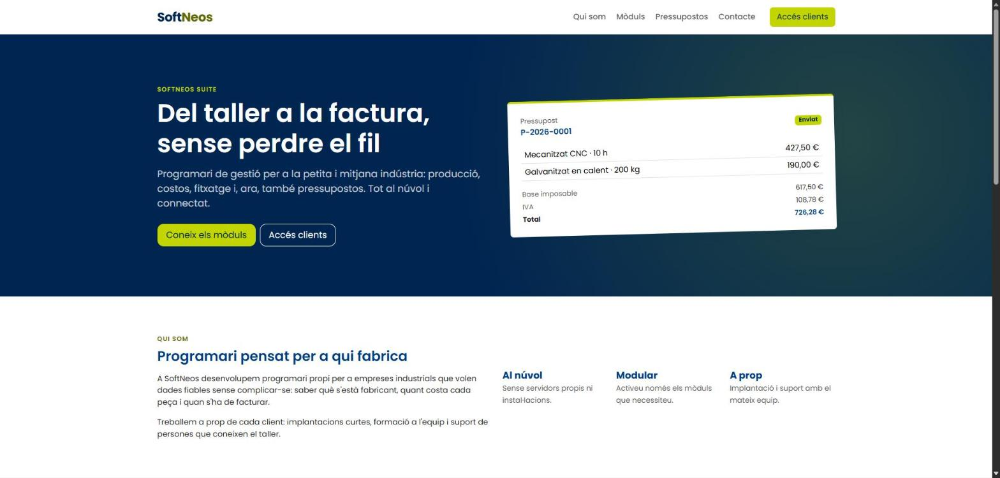
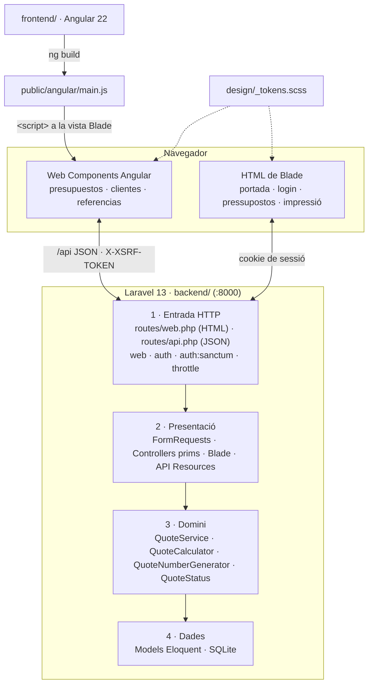
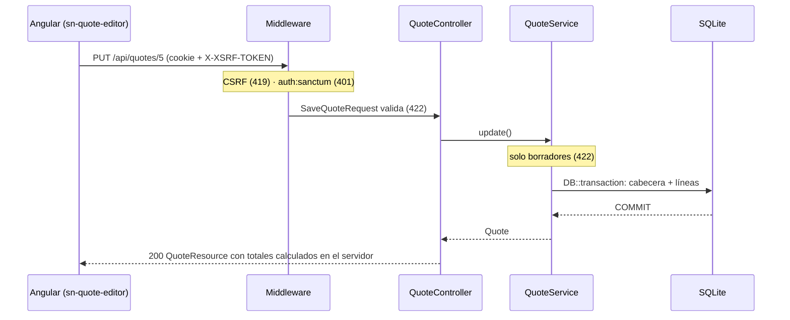

# SoftNeos Pressupostos

> Web corporativa de SoftNeos amb Blade i un mòdul de pressupostos fet amb Angular, dins de les mateixes pàgines de Laravel.

Prova tècnica «Disseny + programació» (enunciat literal a [`docs/ENUNCIAT.md`](docs/ENUNCIAT.md)).



## Descripción

- **Web corporativa (Blade):** una sola página con hero, quiénes somos, módulos de SoftNeos Suite y contacto. **Los módulos se leen de la base de datos** (tabla `suite_modules`), sin necesidad de iniciar sesión.
- **Área de clientes (Blade + Angular):** login con sesión de Laravel, gestión de presupuestos y mantenimiento de clientes y referencias. Las pantallas interactivas son **componentes Angular registrados como Web Components** (`<sn-quote-list>`, `<sn-quote-editor>`, `<sn-customer-list>`, `<sn-reference-list>`) que Blade inserta como cualquier etiqueta HTML.
- **Vista imprimible (Blade):** presupuesto en A4 con desglose de IVA, listo para Ctrl+P.

Toda la interfaz está en catalán. Los datos de demo son de talleres ficticios del sector metal.

## Stack

| Pieza | Versión |
| --- | --- |
| Laravel | 13.x |
| PHP | 8.3 o superior (desarrollado con 8.5) |
| Angular | 22.2 (`@angular/elements`, signals, zoneless) |
| Bootstrap | 5.3 personalizado con SCSS |
| Base de datos | SQLite |
| Autenticación | Sesión de Laravel + Sanctum en modo SPA para `/api` |
| Tests | PHPUnit (backend) |

## Arquitectura

Blade es el motor de plantillas de toda la web; Angular aporta las vistas interactivas dentro de esas plantillas. Un solo servidor, un solo origen y una sola sesión: sin proxy, sin CORS.



Flujo al guardar un presupuesto:



```text
softneos-quotes/
├── backend/     Laravel: Blade, API, dominio, tests
├── frontend/    Angular: componentes compilados como Web Components
├── design/      _tokens.scss compartido por Vite (Blade) y Angular CLI
└── docs/        Enunciado, especificación, uso de IA y capturas
```

## Instalación

Requisitos: PHP 8.3+ con las extensiones `pdo_sqlite`, `bcmath`, `intl`, `mbstring` y `fileinfo`; Composer; Node.js 22+ y npm.

```bash
git clone https://github.com/MGurtD/softneos-quotes.git
cd softneos-quotes/backend
composer install
cp .env.example .env
php artisan key:generate
php -r "touch('database/database.sqlite');"   # fichero SQLite vacío (Windows, macOS y Linux)
php artisan migrate --seed
npm install && npm run build    # CSS de Blade (Bootstrap + tokens)
cd ../frontend
npm install && npm run build    # Angular -> backend/public/angular/main.js
cd ../backend
php artisan serve
```

Abre <http://localhost:8000>.

## Uso

- **Credenciales demo:** `demo@softneos.test` / `password` (botón «Accés clients»).
- **Rutas principales:** `/` portada · `/login` · `/pressupostos` listado · `/pressupostos/nou` y `/pressupostos/{id}` editor · `/quotes/{id}/print` vista imprimible · `/clients` y `/referencies` catálogos (búsqueda, alta y edición).
- **Modo desarrollo** (tres terminales): `php artisan serve` y `npm run dev` en `backend/`; `npm start` en `frontend/` (recompila Angular al guardar).
- **Reiniciar los datos de demo:** `php artisan migrate:fresh --seed` (los datos son siempre los mismos: Faker con semilla fija).

## Tests

```bash
cd backend
php artisan test
```

19 tests: cálculo de totales e IVA (unitarios), máquina de estados, numeración correlativa por año, API de presupuestos (401, 422, transiciones, filtros), login, portada con contenido de base de datos y vista imprimible.

## Decisiones técnicas

- **Blade + Angular Elements en lugar de una SPA separada.** El enunciado pide la web «a través de views/blades de Laravel, però també a través de views html que utilitzin Angular». Blade renderiza y protege cada página (`auth`); Angular solo da vida a las partes interactivas. Resultado: un solo origen, la cookie de sesión y el token XSRF funcionan sin configuración.
- **Errores de validación por campo.** `core/form-errors.ts` coloca cada mensaje 422 de Laravel en su control del Reactive Form (por ejemplo, NIF duplicado), así la regla `unique` del servidor se ve donde toca.
- **Contenido público desde la base de datos.** Los módulos de la portada vienen de `suite_modules`: añadir un módulo es un cambio de datos, no de código.
- **Dinero exacto.** Columnas `decimal`, cast `decimal:2` y cálculo con bcmath, redondeando *half up* por línea. `QuoteCalculator` es la única fuente de verdad: la API, la vista imprimible y Angular muestran el mismo total. Angular solo previsualiza mientras se edita.
- **Snapshots en las líneas.** Cada línea copia descripción, precio, tipo de IVA y porcentaje al crearse: un cambio posterior en el catálogo o en la ley no altera presupuestos emitidos.
- **Reglas de negocio fuera de los controllers.** `QuoteStatus::canTransitionTo()` decide las transiciones; `QuoteService` aplica «solo borradores editables» y guarda cabecera y líneas en una transacción. Los errores de regla responden 422 con el mismo formato que la validación.
- **Mass assignment.** `number` y `status` no son `#[Fillable]`: el servidor asigna el número y el estado solo cambia por `PATCH /status`.
- **Login seguro.** `Auth::attempt`, `session()->regenerate()`, mensaje de error genérico y límite de 5 intentos por minuto por email + IP.
- **Diseño.** Paleta y tipografía de SoftNeos en `design/_tokens.scss`, importado antes de Bootstrap. Mejora de accesibilidad: texto azul noche sobre lima (contraste 9,28:1 frente al 1,64:1 del blanco).
- **Fuera de alcance (decisión consciente):** registro de usuarios, roles, PDF, emails, multiempresa y despliegue. Clientes y referencias se crean y editan, pero no se borran: un presupuesto emitido los referencia (una referencia se da de baja con `active`).

## Capturas

| | |
| --- | --- |
|  |  |
|  |  |
|  |  |

## Uso de IA

Declaración completa (herramientas, para qué y prompts representativos) en [`docs/AI_USAGE.md`](docs/AI_USAGE.md).
